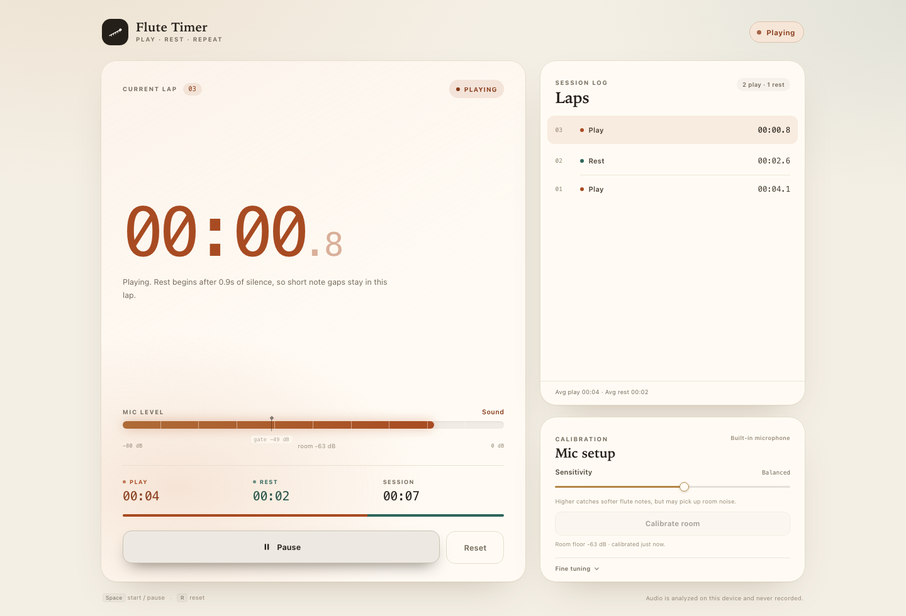

# Flute Timer

A practice timer for flute players. It listens while you play and keeps track of your playing and resting — hands free.



## What this is

Flute Timer is a small program that runs in your web browser. When you start playing, it starts timing. When you stop for a moment, it starts timing your rest. When you play again, it starts a new "play" lap. At the end, you have a simple list showing how long you played and how long you rested.

You don't press anything while you practice. The sound does the work.

## Never used GitHub before?

You're in the right place. **GitHub** is a website where people share small programs like this one. You don't need an account, and you don't need to know anything about programming.

**This download is set up for Mac computers.** If you're on Windows, see [Using a Windows PC](#using-a-windows-pc) near the bottom.

### Step 1 — Download the app

1. Near the top of this page, click the green **Code** button.
2. In the small menu that appears, click **Download ZIP**.
3. Open your **Downloads** folder. You'll see a new file named something like `flute-timer-main.zip`. A ZIP file is just a folder packed into one file.
4. Double-click the ZIP file to unpack it. A new folder appears.
5. Open that folder. Inside, you should see several files, including one called **`start.command`**.

**Keep all of the files together in that folder.** The app needs all of them, so don't move just one file somewhere else.

### Step 2 — Start the app

1. Double-click **`start.command`**.
2. A black window opens. This is called Terminal — don't worry, you don't need to type anything in it. Your web browser should open the app a moment later.
3. Click **Start listening** in the app.
4. When your browser asks whether the app can use your microphone, click **Allow**.
5. Play a note on your flute. The timer starts by itself.

> **Did macOS say the file can't be opened?** This is normal the first time. Right-click (or Control-click) `start.command`, choose **Open**, then click **Open** in the window that appears. You only have to do this once.

> **Is the address bar showing something like `localhost:8787`?** That's normal. It means the app is running on your own computer, not on the internet. It's also why the browser is willing to use your microphone.

> **Keep the black Terminal window open while you practice.** Closing it stops the app. When you're finished, click **Pause** in the app, then close the Terminal window.

After you've downloaded the app, you don't need the internet anymore. It works offline.

## What you'll see

- **The big clock** — how long the lap you're in has been going.
- **Play / Rest / Session** — total time spent playing, resting, and practicing.
- **The colored bar** — a quick picture of your play-versus-rest balance.
- **Laps** — every play and rest stretch, newest first.
- **Mic level** — a moving bar that shows how loud the room is.

## The buttons

| Button | What it does |
| --- | --- |
| **Start listening** | Turns on the microphone and gets ready. The timer starts when you play your first note. |
| **Pause** | Stops listening and freezes the session. |
| **Resume** | Starts listening again and keeps all your laps. |
| **Reset** | Clears the session. Click it twice — the first click asks you to confirm. Your settings stay as they are. |
| **Calibrate room** | Listens to two quiet seconds and adjusts to the background noise in your room. |

## Settings, in plain language

You normally don't need to change anything. If the timer doesn't seem to follow you, these settings can help. The last two are hidden under **Fine tuning**.

- **Sensitivity** — how easily the timer notices your flute. Turn it up if soft notes are missed. Turn it down if the timer keeps starting when you're not playing.
- **Silence before rest** — how long a pause has to last before the timer decides you're resting. Raise it if one lap keeps splitting into pieces while you play short notes.
- **Note must last** — how long a sound has to last before it counts as playing. Raise it if coughs, chair bumps, or page turns start the timer.

**Before you click Calibrate room:** pause the timer, then stay quiet for the two seconds it's measuring. Do this in the room where you actually practice.

## If something goes wrong

**The browser didn't open.**
Open Safari, Chrome, or Firefox yourself, and type the address shown in the black window (usually <http://localhost:8787/app/>). The Terminal window must stay open.

**The black window appeared and closed immediately.**
Your Mac may not have Python 3, which the launcher needs. Go to <https://www.python.org/downloads/>, download the macOS installer, run it, then try `start.command` again.

**The app opens, but it can't hear me.**
- Allow the microphone if your browser asks.
- Check your browser's settings or macOS **System Settings → Privacy & Security → Microphone** to make sure your browser is allowed.
- Close other apps that might be using the microphone, such as a video call.
- Clap or talk and watch the **Mic level** bar. If it doesn't move, the microphone isn't reaching the app.

**It starts when I'm not playing.**
Lower **Sensitivity**, raise **Note must last**, or click **Calibrate room** while the room is quiet.

**It thinks I'm resting in the middle of a phrase.**
Raise **Silence before rest**.

**It misses quiet notes.**
Raise **Sensitivity**, move the microphone closer, or recalibrate.

**I opened `app/index.html` and it says the microphone needs a local server.**
Opening the timer file by itself won't work. Use `start.command` instead. Browsers only allow microphone access through a proper local address like `localhost`.

## Tips for best results

- Use the microphone built into your computer, or a plain USB microphone. Some headsets and speakers apply heavy audio processing that can confuse the timer.
- If you practice with a backing track, use headphones so the app hears your flute and not the speakers.
- Leave the app open on screen while you practice. It tries to keep your display awake.

## Keyboard shortcuts

- <kbd>Space</kbd> — start, pause, or resume
- <kbd>R</kbd> — reset (press again to confirm)

## Your privacy

The microphone audio is measured live in your browser and then thrown away. Nothing is recorded, saved, or sent anywhere. There is no account, no sign-in, and no tracking. After the download, the app doesn't use the internet at all.

## Using a Windows PC

The one-click launcher is for Mac. On Windows, the app can still run in a browser, but it needs a small local web server. That means installing Python 3 and running a command in the Command Prompt. If that sounds unfamiliar, the easiest option is to ask someone technical for help. Here are the exact steps for them:

```bash
cd path\to\flute-timer
python -m http.server 8787
```

Then open <http://localhost:8787/app/> in a browser and allow the microphone.

## For the technically curious

Flute Timer is a static web app with no build step and no dependencies. The files for the timer are:

- `app/index.html` — the timer page layout
- `app/styles.css` — colors, themes, and responsive layout
- `app/app.js` — microphone listening, play/rest detection, laps, and saved settings
- `start.command` — starts a local web server and opens the timer
- `tests/` — automated checks that simulate a flute with a fake microphone

The rest of the folder holds the website around the timer. You don't need it to use the app, but keep it in place so the launcher and links work.

You can also start the server manually on a Mac. Open the Terminal app, type `cd ` (with a space after it), drag the app folder into the Terminal window, press Return, then run:

```bash
python3 -m http.server 8787
```

Then open <http://127.0.0.1:8787/app/>.

To run the automated checks: `python3 tests/test_e2e.py` (requires Playwright).
